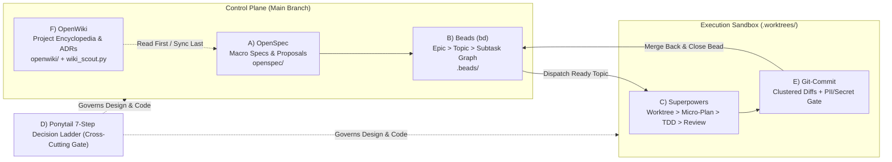

# Six Pillars

**Stop vibe-coding Jenga towers. An anti-entropy GitHub template for AI coding agents.**

> **Interactive Walkthrough:** [Launch the 6-Act Visual Deck](https://akatzmann.github.io/six-pillars/)

Modern coding agents are fast at writing code and equally fast at accumulating architectural drift, forgotten constraints, and context rot across sessions. **Six Pillars** separates your repository into a durable **Control Plane** (specs, task dependency graphs, and institutional memory) and an isolated **Execution Sandbox** (git worktrees + TDD), gated by a 7-step anti-bloat decision ladder.

---

## Architecture at a Glance



| Pillar | Role | Plane | Directory / Tool |
| :--- | :--- | :--- | :--- |
| **A) OpenSpec** | Macro lifecycle (`explore -> propose -> apply -> verify -> archive`) & delta specs | Control Plane | `openspec/` (`openspec` CLI) |
| **B) Beads** | Git-backed dependency graph (`epic -> feature -> task`) replacing fragile markdown checkboxes | Control Plane | `.beads/` (`bd` CLI) |
| **C) Superpowers** | Isolated git-worktree execution: micro-plan, strict Red-Green-Refactor TDD, two-stage review, clean merge | Execution Sandbox | `.worktrees/` + `.agents/skills/superpowers-*` |
| **D) Ponytail** | 7-step minimalism ladder (*YAGNI -> Reuse -> Stdlib -> Native -> Installed -> One-liner -> Minimal code*) | Cross-Cutting | [`AGENTS.md`](AGENTS.md) |
| **E) Git-Commit** | Diff clustering, conventional `[AI]` commit messages, `Verified:` trailers, and PII/secret/absolute-path gate | Cross-Cutting | [`.agents/skills/git-commit/SKILL.md`](.agents/skills/git-commit/SKILL.md) |
| **F) OpenWiki** | General project encyclopedia (domain knowledge, architecture, ADRs, caveats, runbooks) with OKF v0.2 provenance | Control Plane | `openwiki/` (`openwiki` CLI + [`wiki_scout.py`](.agents/skills/openwiki/scripts/wiki_scout.py)) |

---

## Prerequisites

Install the lightweight CLIs used by the workflow skills:

| Tool | Purpose | Upstream |
| :--- | :--- | :--- |
| **Git** | Worktree isolation and version control | [git-scm.com](https://git-scm.com/) |
| **OpenSpec (`openspec`)** | Spec validation and change lifecycle | [Fission-AI/OpenSpec](https://github.com/Fission-AI/OpenSpec) |
| **Beads (`bd`)** | Dependency-tracked issue hierarchy | [steveyegge/beads](https://github.com/steveyegge/beads) |
| **OpenWiki (`openwiki`)** | Project encyclopedia & graph visualizer *(optional if using `wiki_scout.py` + agent skills directly)* | [langchain-ai/openwiki](https://github.com/langchain-ai/openwiki) |
| **Python 3** | Zero-dependency stdlib runner for [`wiki_scout.py`](.agents/skills/openwiki/scripts/wiki_scout.py) | [python.org](https://www.python.org/) |
| **GitHub CLI (`gh`)** | Optional; only required for [`git-release`](.agents/skills/git-release/SKILL.md) | [cli.github.com](https://cli.github.com/) |

---

## Quick Start

1. **Create your repo:** Click **"Use this template"** on GitHub and clone your new repository.
2. **Run Day-Zero Bootstrap** (or let your coding agent run Rule 6 of [`AGENTS.md`](AGENTS.md) automatically on its first turn):
   ```bash
   [ -d .git ] || git init
   [ -f openspec/config.yaml ] || openspec init --tools none --no-animation
   bd init --init-if-missing --prefix bd --non-interactive --skip-agents --skip-hooks
   ```
3. **Replace this `README.md`** with your project's own README while keeping `AGENTS.md`, `.agents/`, `openspec/`, and `openwiki/`.
4. **Drive every feature through the lifecycle:**
   - `/opsx-explore` (read-only thinking partner grounded in OpenWiki + Ponytail ladder)
   - `/opsx-propose` (delta specs, design doc, and Beads `epic -> feature -> task` graph)
   - `/opsx-apply` (dispatches ready topics into isolated Superpowers TDD worktrees)
   - `/opsx-verify` (spec coverage, invariants, caveats, and Ponytail audit)
   - `/opsx-archive` (syncs specs, closes Beads epic, updates OpenWiki, archives change)

---

## What's Included

```text
.
├── AGENTS.md                       # Canonical engineering constitution & Ponytail 7-step ladder
├── LICENSE                         # Apache-2.0 license
├── NOTICE                          # Third-party MIT attribution & derivative notices
├── openspec/                       # Spec-driven change scaffold (config.yaml, specs/, changes/)
├── openwiki/                       # OKF v0.2 encyclopedia charter (INSTRUCTIONS.md, index.md)
└── .agents/
    ├── rules/AGENTS.md             # Symlink -> ../../AGENTS.md for toolchains scanning .agents/rules/
    └── skills/                     # 14 portable Agent Skills + zero-dependency wiki_scout.py
```

### Bundled Skills (14)

| Category | Skills |
| :--- | :--- |
| **OpenSpec Lifecycle (6)** | [`opsx-explore`](.agents/skills/opsx-explore/SKILL.md), [`opsx-propose`](.agents/skills/opsx-propose/SKILL.md), [`opsx-apply`](.agents/skills/opsx-apply/SKILL.md), [`opsx-verify`](.agents/skills/opsx-verify/SKILL.md), [`opsx-archive`](.agents/skills/opsx-archive/SKILL.md), [`opsx-bulk-archive`](.agents/skills/opsx-bulk-archive/SKILL.md) |
| **Superpowers Sandbox (5)** | [`superpowers-using-git-worktrees`](.agents/skills/superpowers-using-git-worktrees/SKILL.md), [`superpowers-writing-plans`](.agents/skills/superpowers-writing-plans/SKILL.md), [`superpowers-test-driven-development`](.agents/skills/superpowers-test-driven-development/SKILL.md), [`superpowers-subagent-driven-development`](.agents/skills/superpowers-subagent-driven-development/SKILL.md), [`superpowers-finishing-a-development-branch`](.agents/skills/superpowers-finishing-a-development-branch/SKILL.md) |
| **Knowledge & Git Hygiene (3)** | [`openwiki`](.agents/skills/openwiki/SKILL.md) (+ [`wiki_scout.py`](.agents/skills/openwiki/scripts/wiki_scout.py)), [`git-commit`](.agents/skills/git-commit/SKILL.md), [`git-release`](.agents/skills/git-release/SKILL.md) |

---

## Multi-Agent Compatibility

This template uses the open **`AGENTS.md`** + **`.agents/skills/`** standard so one file tree works across modern coding agents with zero duplicated rule files:

- **Native support:** Antigravity, Claude Code (`v2.1.277+`), GitHub Copilot (CLI & IDE), Codex, Cursor, Zed, and Aider.
- **Older Claude Code (`< v2.1.277`):** Add a 1-line `CLAUDE.md` at the repo root containing `@AGENTS.md`.
- **Windows clones:** `.agents/rules/AGENTS.md` is a relative symlink to `../../AGENTS.md`. Clone with `git clone -c core.symlinks=true <url>` (or delete `.agents/rules/AGENTS.md` if your agent already loads root `AGENTS.md`).

---

## License & Upstream Lineage

Licensed under **[Apache-2.0](LICENSE)** by [@akatzmann](https://github.com/akatzmann). See [`NOTICE`](NOTICE) for full third-party acknowledgments and derivative-work notices:

- **Superpowers** by Jesse Vincent ([obra/superpowers](https://github.com/obra/superpowers), MIT)
- **OpenSpec** ([Fission-AI/OpenSpec](https://github.com/Fission-AI/OpenSpec), MIT)
- **Ponytail** minimalism principles by Dietrich Gebert ([dietrichgebert/ponytail](https://github.com/dietrichgebert/ponytail), MIT)
- **OpenWiki** ([langchain-ai/openwiki](https://github.com/langchain-ai/openwiki), MIT)
- **Beads (`bd`)** external CLI by Steve Yegge ([steveyegge/beads](https://github.com/steveyegge/beads))
